# cache-de-conteudo

Exercício — Cache de Conteúdo com HashMap no Spring Boot

## Como rodar

Com o JDK 21 ou superior, abra um terminal na pasta do `pom.xml`. No Windows, execute no PowerShell.

```powershell
.\mvnw.cmd spring-boot:run
```

No Linux ou macOS, use `sh ./mvnw spring-boot:run`. A API fica disponível em `http://localhost:8080` e usa o H2 em memória.

## Como o cache funciona

O `GET /conteudos/{id}` procura o conteúdo em um `ConcurrentHashMap`. Se encontrar uma entrada válida, devolve o conteúdo do cache (**HIT**). Se a entrada estiver ausente ou expirada, espera 2 segundos para simular a lentidão, busca no H2 e guarda o conteúdo encontrado (**MISS**). O header `X-Cache` mostra o resultado. O log registra HIT ou MISS, o ID e o tempo da busca.

O cache guarda até **5 conteúdos**, com TTL de **120 segundos** contados desde o armazenamento. Quando o cache está cheio, a entrada há mais tempo sem acesso sai para dar lugar à nova (**LRU**). Atualizar ou excluir um conteúdo invalida sua entrada.

`GET /cache/estatisticas` mostra o tamanho, o limite, os hits, os misses, as remoções por limite e a taxa de acertos. `DELETE /cache` limpa as entradas e mantém os contadores.

## Demonstração

### MISS e HIT

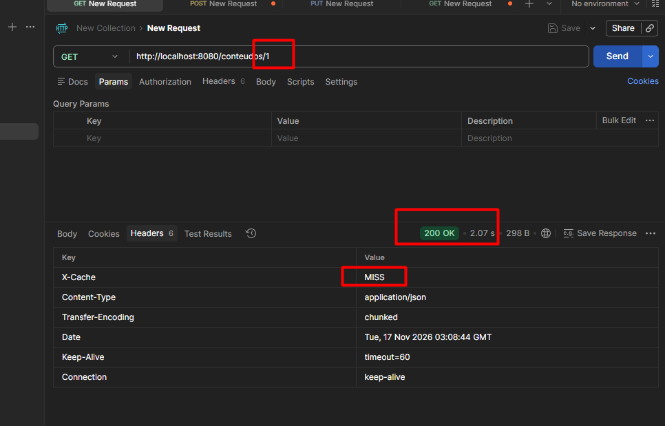

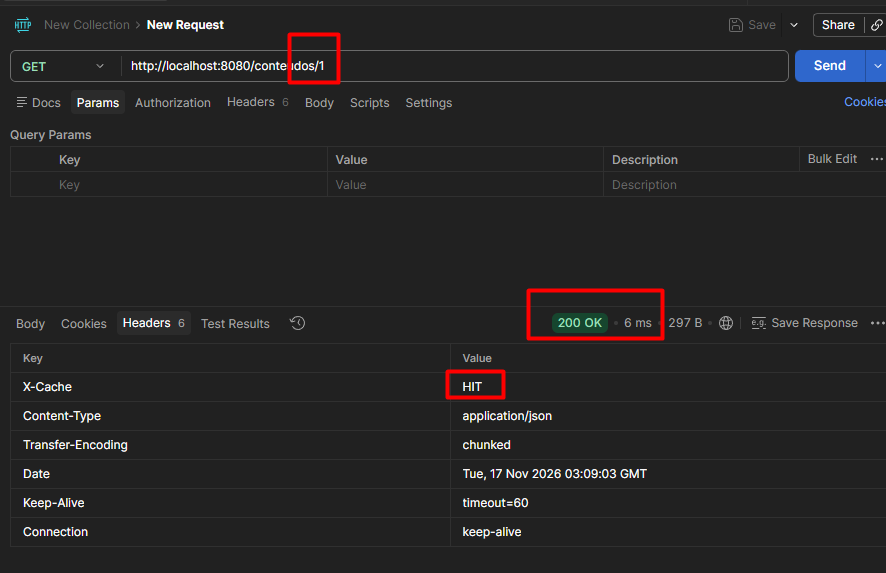

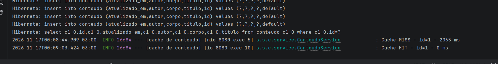

### Remoção por LRU

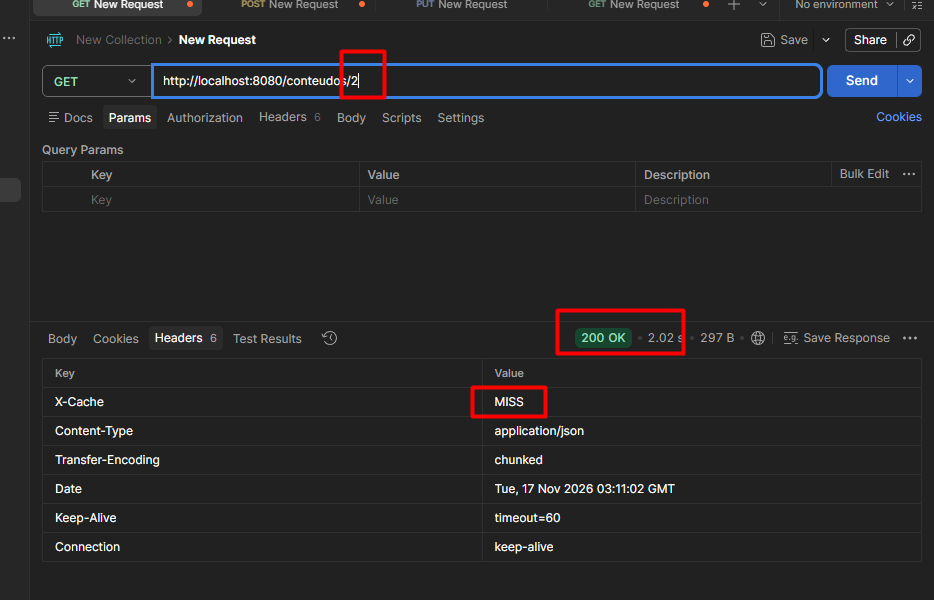

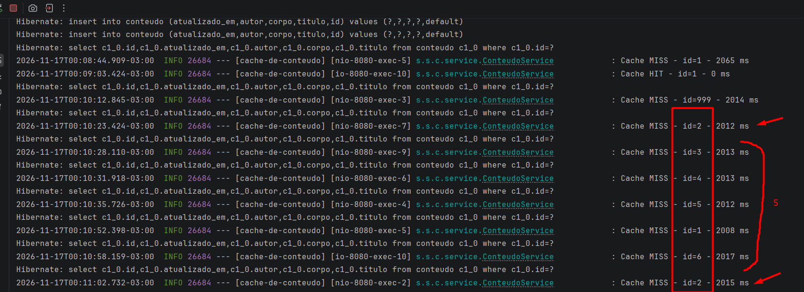

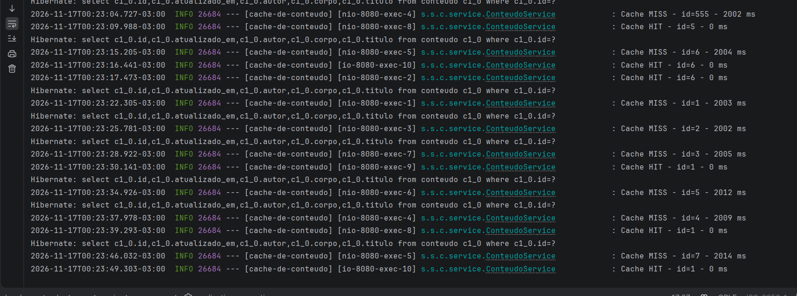

### Invalidação após PUT

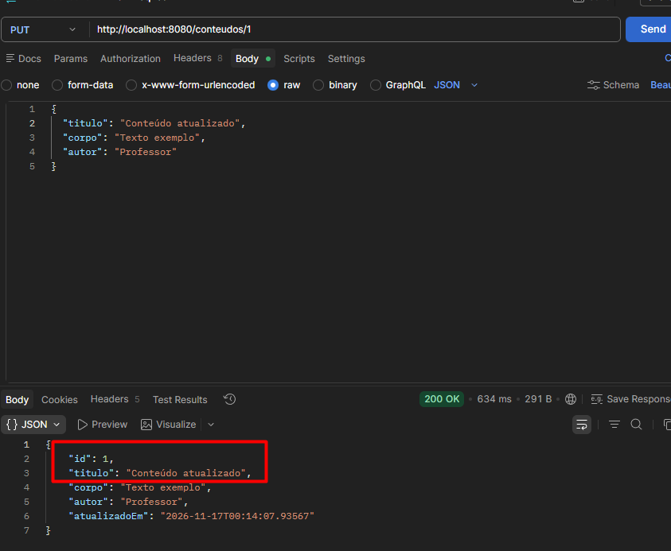

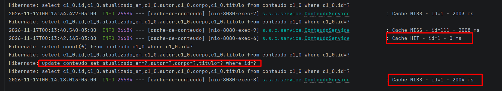

### Expiração por TTL

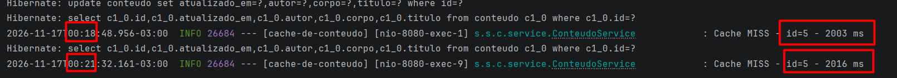

### Estatísticas

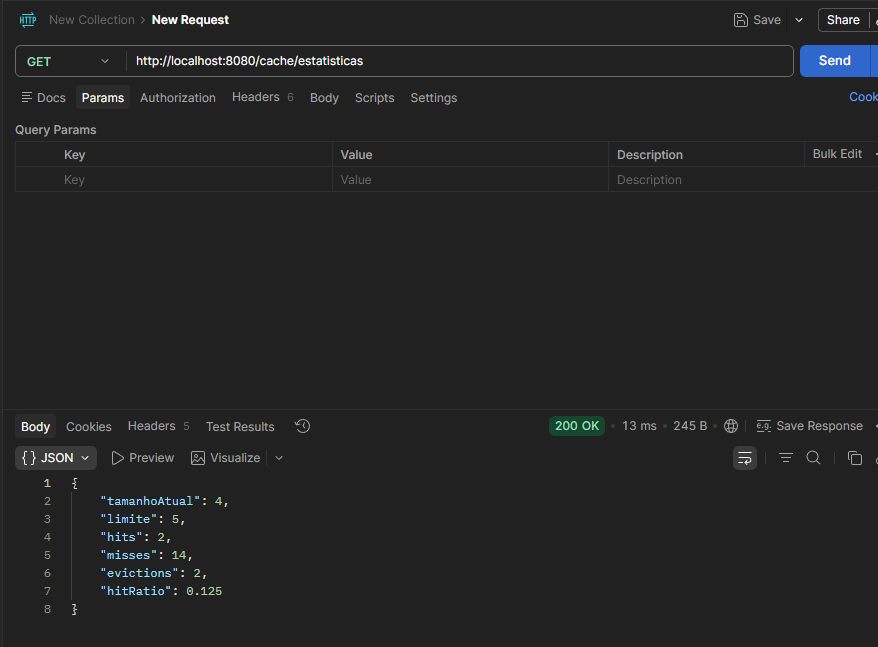

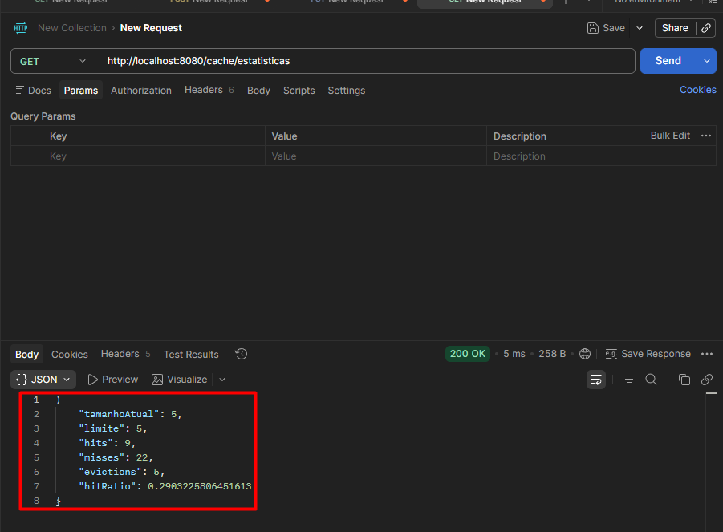
